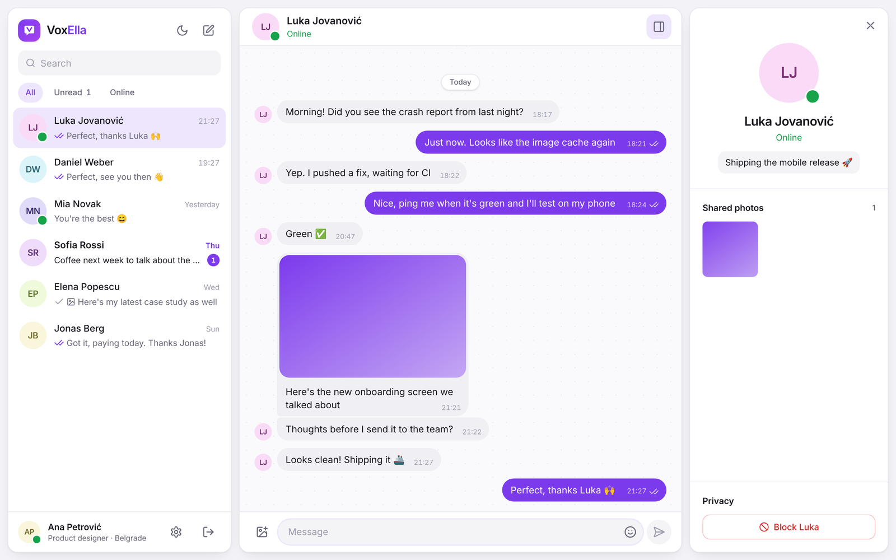
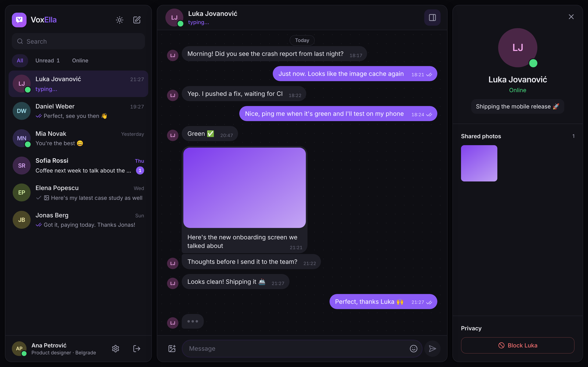
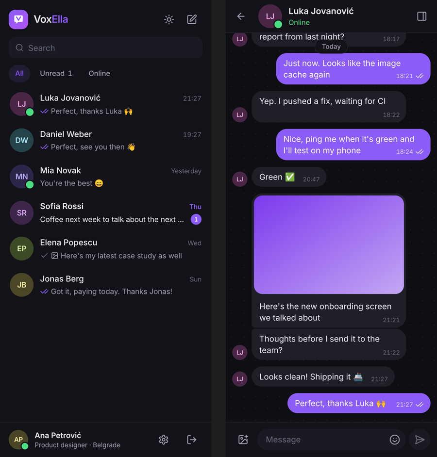

# VoxElla

Real-time one-to-one messaging: text, photos, typing indicators, read receipts and presence, on every device you're signed in on.

**[Live demo](https://chat-app-voxella-1.onrender.com/)** · Express · Socket.IO · MongoDB · React 19 · Tailwind CSS 4



| Dark theme, someone typing | Phone |
|---|---|
|  |  |

## Features

- **Instant delivery.** Messages appear for the other person and in all of your own tabs as soon as they're sent. Your own messages show up right away and are confirmed by the server; a failed send can be retried.
- **Read receipts and typing.** ✓ sent, ✓✓ seen, live "typing…" in the chat and in the list, and unread badges in the list and the tab title.
- **Presence.** Online dots and "last seen 5 min ago". A second tab doesn't count as a new arrival, and closing one of two tabs doesn't count as leaving.
- **Photos.** Attach, paste or drag a photo in, with an optional caption. The full-screen viewer has a download button, and each chat's details panel shows its shared photos.
- **History.** Older messages load as you scroll up, without the view jumping. Messages are grouped by day and by sender.
- **People.** Search by name or by exact email to start a chat. You can block and unblock people; a block works in both directions and stops their messages, typing indicator and search results.
- **Profile and settings.** Profile photo, name, status and email, password change, and a list of blocked people. Light, dark or system theme with five accent colours.
- **Reconnection.** A banner shows while the connection is down. Anything missed is fetched once the connection is back.
- **Layout.** Three panes on wide screens, two on tablets and one on phones. The URL decides which chat is open (`/c/:id`), so the browser's back button and deep links work.

## Architecture

```
chat-app-backend/            Express 5 API + Socket.IO
  src/app.js                 app factory (dependencies injected, so tests need no network)
  src/server.js              HTTP server, MongoDB connection, graceful shutdown
  src/config/env.js          environment validated with zod at startup
  src/routes/                auth, users, conversations
  src/services/              conversation and message logic
  src/realtime/socket.js     socket auth, presence, typing, emit helpers
  src/lib/storage.js         Cloudinary when configured, local disk otherwise
  scripts/seed.js            demo data
  scripts/migrate-conversations.js   one-off upgrade of v1 data
  test/                      Vitest + Supertest + real Socket.IO clients

chat-app-frontend/           React 19 + Vite
  src/stores/chat.js         conversations, threads, presence, typing (Zustand)
  src/lib/socket.js          socket events → store
  src/components/            sidebar, chat, details, UI primitives
  src/pages/                 auth, chat, settings
```

### Data model

- **User**: email (unique, lower-case), name, bcrypt password hash (never returned), photo, status, blocked users, `lastSeenAt`.
- **Conversation**: one document per pair of users, made unique by a sorted `key`. It also stores the last message and the unread count for each person, so the chat list is a single indexed query.
- **Message**: belongs to a conversation, with sender, receiver, text and/or image, and `readAt`. It is indexed for paging (`conversationId, _id`) and for read receipts.

### Realtime events

The socket is authenticated with the same httpOnly JWT cookie as the API. Each user joins a private room `user:<id>`, so an event reaches every tab and device that user has open.

| Event | Direction | Payload |
|---|---|---|
| `presence:snapshot` | server → client | `{ online: userId[] }` on connect |
| `presence:update` | server → client | `{ userId, online, lastSeenAt? }` |
| `message:new` | server → client | `{ message, conversation }`, with the conversation as that user sees it |
| `conversation:read` | server → client | `{ conversationId, readerId, readAt }` |
| `typing` | both ways | `{ conversationId, isTyping }`; forwarded only to the other participant |
| `block:updated` | server → client | `{ userId, blockedByMe? , blockedMe? }`; sent only to the two people involved |
| `user:updated` | server → client | `{ user }`; sent to the people you chat with when your profile changes |

Messages are sent over REST (`POST /api/conversations/:id/messages`) and fanned out over the socket. That gives sending validation, status codes and tests, and keeps the socket for pushing events only.

### API

| Method | Path | |
|---|---|---|
| POST | `/api/auth/register`, `/api/auth/login`, `/api/auth/logout` | session cookie |
| GET | `/api/auth/me` | current user |
| GET | `/api/users?search=` | people search (name, or exact email) |
| PATCH / PUT | `/api/users/me`, `/api/users/me/avatar`, `/api/users/me/password` | profile |
| GET | `/api/users/me/blocked`, `/api/users/:id` | |
| POST / DELETE | `/api/users/:id/block` | block, unblock |
| GET / POST | `/api/conversations` | list, open with a user |
| GET | `/api/conversations/:id`, `/:id/messages?before=&limit=`, `/:id/media` | |
| POST | `/api/conversations/:id/messages` | JSON or multipart (`text`, `image`) |
| POST | `/api/conversations/:id/read` | read receipt |
| GET | `/api/health` | liveness + database state |

Errors always have the same shape: `{ message, code, issues? }`.

### Security

- The JWT is in an httpOnly, `SameSite=Strict` cookie (`Secure` in production) and is also checked on the socket handshake.
- Passwords are hashed with bcrypt. A login with an unknown email takes as long as one with a wrong password, and both give the same answer.
- Request bodies, queries and ids are validated with zod. Uploads must be images (JPG, PNG, WebP, GIF) of at most 5 MB.
- Helmet adds the security headers, with a Content-Security-Policy and no inline scripts. Login and sign-up are rate limited, and the API has a general rate limit.
- Someone outside a conversation gets a 404 for it, not a 403, so conversation ids can't be probed.

## Getting started

You need Node.js 20+ and MongoDB, either local or a free [Atlas](https://www.mongodb.com/atlas) cluster.

```bash
# API
cd chat-app-backend
cp .env.example .env          # set MONGO_URI and JWT_SECRET
npm install
npm run seed                  # optional: demo people and conversations
npm run dev                   # http://localhost:5000

# Web app, in a second terminal
cd chat-app-frontend
npm install
npm run dev                   # http://localhost:5173
```

After `npm run seed`, sign in as `ana@demo.test` with password `password123`. Signing in as `luka@demo.test` in a second browser shows typing, presence and read receipts working live.

Cloudinary is optional. Without it, photos are saved to `chat-app-backend/uploads/`.

## Tests

```bash
cd chat-app-backend && npm test     # 39 tests: auth, users, conversations, messages, sockets
cd chat-app-frontend && npm test    # 23 tests: chat store, composer, formatting
npm run lint                        # both projects, from the repository root
```

The API tests run against a throwaway in-memory MongoDB that downloads itself on the first run. To use your own instance instead, set `MONGO_TEST_URI`. The socket tests start a real server and connect real Socket.IO clients. GitHub Actions runs everything on every push and pull request.

## Deployment (Render)

| Setting | Value |
|---|---|
| Build command | `npm run build` |
| Start command | `npm start` |
| Environment | `NODE_ENV=production`, `MONGO_URI`, `JWT_SECRET`, `CLOUDINARY_*` |

In production the API also serves the built frontend, so everything runs on one origin. To host the frontend separately, set `CORS_ORIGIN` on the API and `VITE_API_URL` on the frontend. The cookie then switches to `SameSite=None; Secure`.

**Upgrading from v1:** run `npm run migrate` once in `chat-app-backend` against the production database. It groups the existing messages into conversations and lower-cases email addresses. Running it again is safe.

## Author

**Marko Spasojević** · [GitHub @spasojewagner](https://github.com/spasojewagner) · [LinkedIn](https://www.linkedin.com/in/marko-spasojevic-metoda)

Released under the [MIT License](LICENSE).
